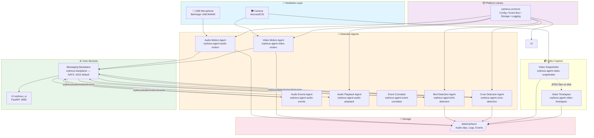
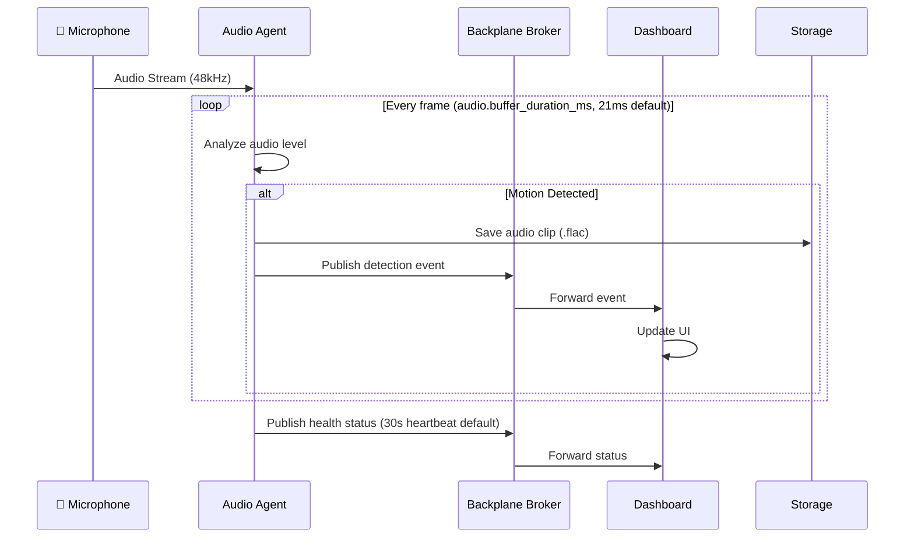
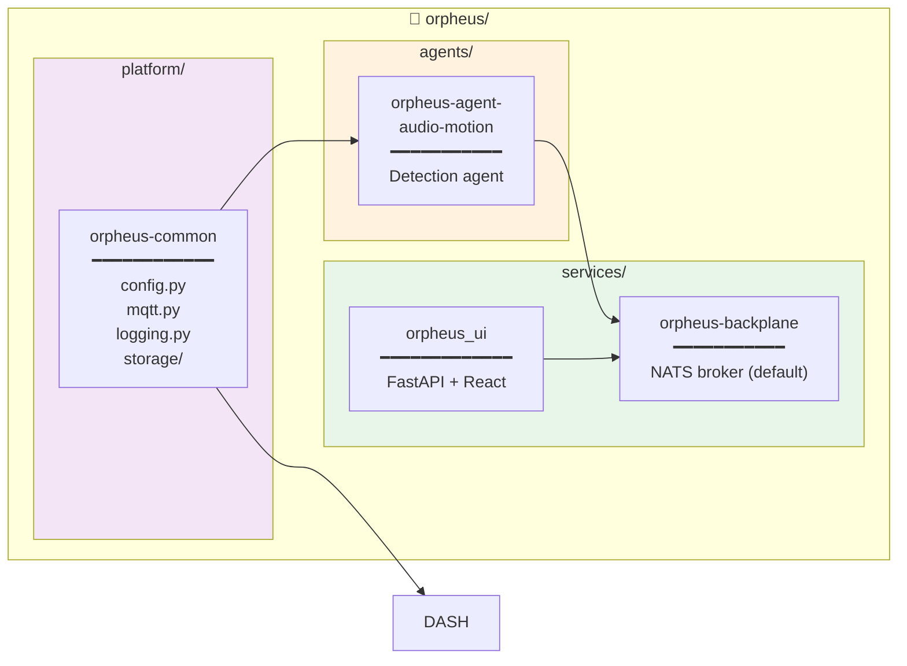
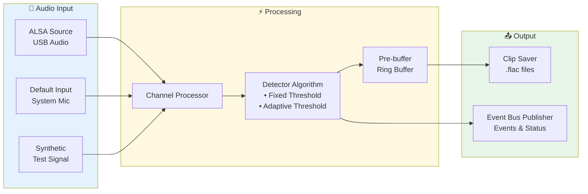
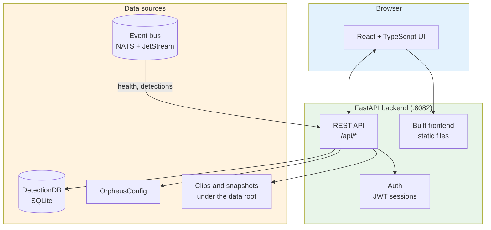
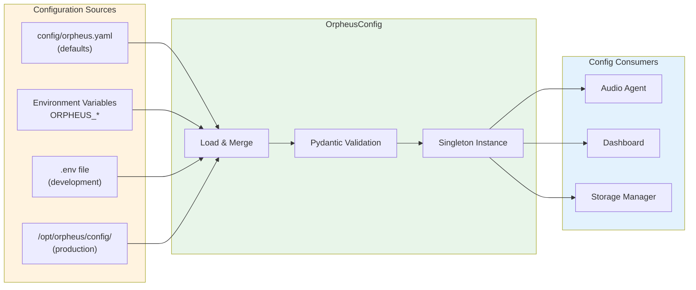
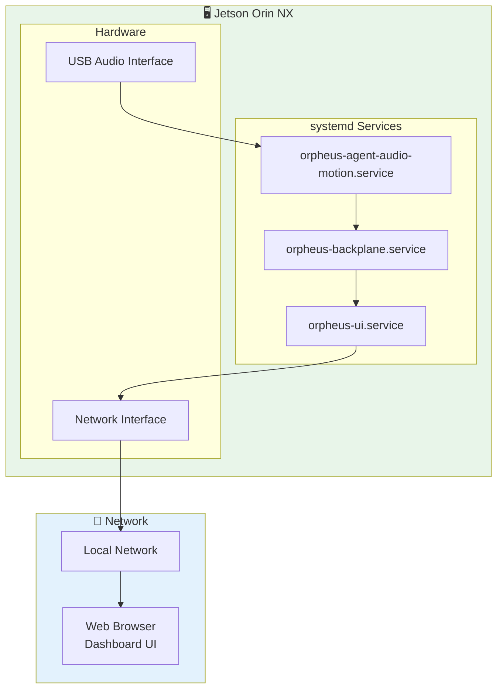
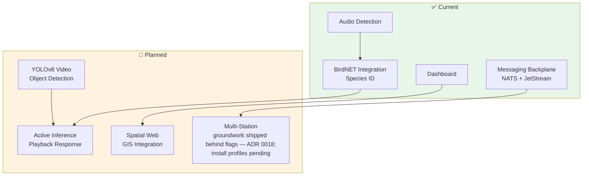

# Orpheus Architecture

This document describes the high-level architecture of the Orpheus wildlife monitoring and cross-species communication platform.

## Overview

Orpheus is a portable, modular wildlife observation and interaction platform.
Jetson is one validated deployment, not the definition of the platform. The
platform follows a modular, service-oriented architecture that enables:

- **Real-time audio/video processing** with low-latency ML inference
- **Distributed agent communication** via a messaging backplane (NATS + JetStream by default; mosquitto/MQTT as the fallback — see [ADR 0017](adr/0017-actor-model-nats-backplane.md))
- **Edge deployment** on resource-constrained hardware
- **Configurable deployment** across supported hardware and compatible runtimes

## Architecture contract

**Configure the capability, not the machine.** Read this contract before changing
architecture, configuration, runtime behavior or deployment. The decision and
tradeoffs are recorded in [ADR 0020](adr/0020-portable-capabilities-and-runtime-boundaries.md).
The [contribution workflow](contributing.md#making-changes) defines the review gate.

### Capabilities, models and execution

Agents implement domain capabilities. Hardware implementations are replaceable
backends selected through the owning component's configuration. An agent should
be portable to ordinary Linux, macOS, Raspberry Pi and other platforms wherever
its dependencies and hardware interfaces are supported. This is a design
requirement, not a claim that every backend or installer works everywhere.
Explicit unsupported selections must fail clearly; automatic selection considers
only implemented, supported combinations and respects explicit model/device choices.

Keep these responsibilities separate:

| Boundary | Owns | Current example |
|---|---|---|
| Agent/domain | Input subscription, admission policy, preprocessing, post-processing, lineage, publication and persistence | audio-events: `audio.motion` → `audio.classified` |
| Model implementation | Checkpoint, sample/score shapes, labels and model-specific runtime validation | PANNs Cnn14 in audio-events and `orpheus-worker-panns` |
| Hardware backend | Supported device placement and framework execution | In-process PANNs CPU/CUDA; isolated validated Jetson CUDA runtime |
| Process/IPC infrastructure | Framing, exchange deadlines, process ownership, reaping, recovery and caller-supplied resource guards | `orpheus-inference` |
| Host resource coordination | Cross-model admission, fairness and aggregate accelerator capacity | No scheduler ships; deployment budgets remain explicit |

`orpheus-inference` names its reusable inference process infrastructure accurately;
it contains no PANNs model, event bus, detection policy, NVIDIA dependency or
host-wide scheduler. Keep the package boundary. BirdNET, crow and video inference
can reuse suitable IPC/lifecycle parts with separate model processes and runtimes;
they are not implemented in this milestone. A future implementation need not use
a subprocess if its compatible in-process backend is sufficient.

### Runtimes and hardware resources

Python versions and dependency pins belong to components. Current agent/service
packages generally declare Python 3.9; the validated Jetson PANNs CUDA worker
declares Python 3.8 with its NVIDIA stack. The shared IPC library supports 3.8+.
Those are implementation constraints, not an Orpheus-wide Python requirement.
Read each package's metadata, Makefile and constraints before changing it. Shared
code must support its actual consumers. Modernizing non-GPU agents can proceed
independently in future work without replacing the CUDA worker runtime.

The owning agent supplies concurrency, queue capacity, device, worker lifecycle,
timeouts and memory policy through `OrpheusConfig`. Follow
[ADR 0018](adr/0018-distributed-backplane-and-config-service.md): environment
(including loaded dotenv values) > optional shared KV > selected local YAML >
component defaults. YAML path discovery selects a file; it does not merge all
platform files. Platform/deployment configuration chooses capabilities and
overrides defaults; measurements from one installation do not establish universal
minimums. [Configuration](operator-manual/index.md#2-configuration) is the operator entry.

Memory guards are observations, not reservations. On the tested Jetson, CPU and
GPU share RAM, and cgroup accounting does not capture all driver allocations.
Host budgets must account for concurrent cold starts, resident models, encodes
and peak inference. A serial PANNs child is one implementation choice. Sensor
lists, models, accelerators and hosts have no fixed architectural count. Extra
capacity may require another backend or deployment topology, not different
detection semantics. Multiple hosts also need accessible recordings and the
secured transport/deployment work described in ADR 0018; a changed broker URL
alone does not share files.

Introduce host-wide accelerator coordination only when representative concurrent
workloads demonstrate contention: memory failures, starvation, sustained queue
growth, rejection or missed deployment latency objectives. Record residency,
load/peak memory, queue age/depth, throughput and competing workload measurements
first. Prefer the smallest justified mechanism; neither a giant shared process
nor a common Python version follows from needing coordination.

### Domain semantics survive backend changes

For identical model scores and classification settings, CPU and GPU execution
must produce the same labels, intervals, taxonomy, source context and lineage on
the same output topic. Each agent publishes and persists the same Detection
identity ([ADR 0012](adr/0012-agents-own-their-detection-stream.md)); independent
runs can mint different event IDs and have different publication times/latencies.
Numerical model parity remains separately validated on supported hardware.

The correlator owns temporal/source correlation and late enrichment
([ADR 0013](adr/0013-source-identity-entities.md)). Its inactivity window is **not**
an audio classification deadline. An old available recording remains valid work
unless an operator has explicitly selected a documented rejection policy.
Storage retention is owned by the storage sweep, not an inference worker.

Any queue rejection, expiry, retry, shutdown cancellation or degradation policy
must name its owner, reason, configuration, defaults and observability, and have
behavioral tests. IPC exchange timeouts bound a faulty exchange; worker recovery
does not authorize discarding work by recording age, silently loading another
model or inventing retries. Current PANNs worker limits and rejection counters are
documented in the [operator guide](operator-manual/panns-gpu.md#budget-memory-and-overload).
Its bounded queue can reject clips and does not automatically replay them; selecting
it requires evaluating that coverage tradeoff. Do not describe it as lossless.

SQLite remains authoritative today. JetStream domain shadowing is optional and
bounded, core NATS subscriptions are at-most-once, and current replay is not an
authoritative classifier work queue. Follow the
[determinism contract](designs/event-sourcing-determinism-contract.md) before
changing delivery, acknowledgement or replay. Operational health/rejection
counters stay outside the durable domain log. Tests and self-review establish
evidence; independent review establishes acceptance.

## System Architecture



Solid edges are event-bus subscriptions — no agent calls another directly.
The dashed edge is a filesystem handoff: the snapshotter writes JPEGs and the
timelapser reads them, with no bus involvement (ADR 0002).

## Data Flow



## Component Architecture

### Monorepo Structure



## Platform Constraints

| Constraint | Requirement |
| ------------ | ------------- |
| **Hardware support** | Backend/dependency specific; Jetson and macOS are validated deployments |
| **Python Version** | Per-component metadata and constraints; see [runtime contract](#runtimes-and-hardware-resources) |
| **Development Platforms** | macOS, Linux; validate each changed platform path |
| **ML Framework** | PyTorch + CUDA (crow-detection, audio-events); ONNX Runtime on CPU (bird-detection); TFLite for BirdNET's geo-filter |

## Audio Processing Pipeline



## Dashboard Architecture

The dashboard is `services/orpheus_ui`: a React + TypeScript frontend built with
Vite, served as static files by a FastAPI backend that also exposes the API. The
backend reads the detection database directly and subscribes to the event bus for
live health and detection updates.



The backend can be pointed at a read-only replica instead of the live database
(`ui.read_from_replica`), so history browsing reads a snapshot rather than the
database the agents are writing to.

## BUS Topic Structure

The `orpheus/...` hierarchy below is the wire contract on either backend: NATS
(default) mirrors it as subjects; the mosquitto fallback uses it as literal BUS
topics.

```mermaid
graph TD
    ROOT[orpheus/]
    
    ROOT --> AUDIO[audio/]
    ROOT --> DETECTION[detection/]
    ROOT --> ENTITIES[entities/]
    ROOT --> SYSTEM[system/]
    ROOT --> VIDEO[video/]
    
    AUDIO --> A_EVENTS[motion/events<br/>Audio motion events]
    AUDIO --> A_STATUS[motion/status<br/>Channel status]
    AUDIO --> A_PLAYBACK[playback/request<br/>Playback requests]
    
    DETECTION --> D_BIRD[bird/events<br/>BirdNET detections]
    DETECTION --> D_CROW[crow/events<br/>Crow detections]
    DETECTION --> D_AUDIO[audio/events<br/>PANNs sound-event detections]
    
    ENTITIES --> E_ANIMAL[animal<br/>Correlated entity events]
    
    SYSTEM --> S_HEALTH[*/health<br/>Agent health]
    SYSTEM --> S_CONFIG[config_changed<br/>Config changes]
    SYSTEM --> S_SAFETY[safety<br/>Circuit-breaker state]
    DETECTION --> D_REPLAY[replay<br/>Replayed detections]
    STATE[state/] --> S_LOC[location<br/>GPS fix, retained]
    ENV[environment/] --> WX[weather<br/>Ecowitt readings — stubbed]
    ACT[actuation/] --> A_PB[audio/playback<br/>Playback windows]
    EU[entity-updates/] --> EU_A[animal<br/>Late-arrival enrichment]
    
    VIDEO --> V_EVENTS[motion/events<br/>Motion events]
    VIDEO --> V_STATUS[motion/status<br/>Camera status]

    style ROOT fill:#1565c0,color:#fff
    style AUDIO fill:#2196f3,color:#fff
    style DETECTION fill:#9c27b0,color:#fff
    style ENTITIES fill:#c2185b,color:#fff
    style SYSTEM fill:#4caf50,color:#fff
    style VIDEO fill:#ff9800,color:#fff
```



## Configuration Flow



## Deployment Architecture



## Directory Structure

```bash
orpheus/
├── platform/
│   └── orpheus-common/       # Shared platform library
│       ├── src/orpheus_common/
│       │   ├── config.py     # Configuration management
│       │   ├── event_bus.py  # EventBus ABC + factory
│       │   ├── event_bus_nats.py # NATS + JetStream backend
│       │   ├── mqtt.py       # mosquitto fallback backend
│       │   ├── actor/         # Actor base every agent subclasses
│       │   ├── detection/     # Detection, Entity, DetectionDB, taxonomy
│       │   ├── logging.py    # Structured logging
│       │   ├── storage/      # File storage utilities
│       │   ├── hardware/     # Hardware abstraction
│       │   └── diagnostics/  # Health monitoring
│       └── tests/
│
├── services/
│   ├── orpheus-backplane/    # Messaging backplane (NATS default; mosquitto fallback)
│   │   ├── config/
│   │   ├── scripts/
│   │   └── systemd/
│   │
│   ├── orpheus-gps/          # GPS time + location service
│   ├── orpheus-bluetooth-autoconnect/  # Audio-out routing
│   ├── orpheus-dashboard/    # RETIRED — superseded by orpheus_ui; not deployed
│   └── orpheus_ui/           # Web-based UI
│       ├── backend/          # FastAPI backend (port 8082)
│       ├── frontend/         # React + Vite frontend (port 5173 dev)
│       └── systemd/
│
├── agents/
│   ├── orpheus-agent-audio-motion/  # Audio motion detection agent
│   │   ├── src/orpheus_agent_audio_motion/
│   │   │   ├── main.py               # Agent entrypoint
│   │   │   ├── audio_source.py       # Audio capture backends
│   │   │   ├── detector_algorithm.py # Detection algorithms
│   │   │   └── channel_processor.py  # Per-channel processing
│   │   └── tests/
│   │
│   ├── orpheus-agent-video-motion/  # Video motion detection agent
│   │   ├── src/orpheus_agent_video_motion/
│   │   │   ├── main.py               # Agent entrypoint
│   │   │   ├── video_source.py       # RTSP stream capture
│   │   │   └── motion_detector.py    # Motion detection
│   │   └── tests/
│   │
│   ├── orpheus-agent-bird-detection/  # BirdNET species identification
│   │   ├── src/orpheus_agent_bird_detection/
│   │   │   ├── main.py               # Agent entrypoint
│   │   │   └── birdnet_model.py      # BirdNET ONNX inference
│   │   └── tests/
│   │
│   ├── orpheus-agent-crow-detection/  # Crow vocalization analysis
│   │   ├── src/orpheus_agent_crow_detection/
│   │   │   ├── main.py               # Agent entrypoint
│   │   │   ├── embedder.py           # AVES embedder (16kHz)
│   │   │   └── classifier.py         # Multi-task classifier
│   │   └── tests/
│   │
│   ├── orpheus-agent-audio-events/    # General AudioSet sound classification
│   │   ├── src/orpheus_agent_audio_events/
│   │   │   ├── main.py               # Agent entrypoint
│   │   │   ├── model.py              # PANNs sound-event detection
│   │   │   ├── post_processing.py    # Frames → temporal intervals
│   │   │   └── audioset_ontology.py  # AudioSet 527-class ontology
│   │   └── tests/
│   │
│   ├── orpheus-agent-audio-playback/  # Audio output agent
│   │   ├── src/orpheus_agent_audio_playback/
│   │   │   ├── main.py               # Agent entrypoint
│   │   │   └── playback.py           # Audio playback manager
│   │   └── tests/
│   │
│   ├── orpheus-agent-video-snapshotter/  # Periodic camera snapshots
│   │   ├── src/orpheus_agent_video_snapshotter/
│   │   │   ├── main.py               # Agent entrypoint
│   │   │   └── config.py             # Configuration loading
│   │   └── tests/
│   │
│   ├── orpheus-agent-video-timelapser/  # Timelapse generation
│   │   ├── src/orpheus_agent_video_timelapser/
│   │   │   ├── main.py               # Agent entrypoint
│   │   │   └── config.py             # Configuration loading
│   │   └── tests/
│   │
│   └── orpheus-agent-event-correlator/  # Fuses detections into entities
│       ├── src/orpheus_agent_event_correlator/
│       │   ├── main.py               # Agent entrypoint
│       │   └── cluster_manager.py    # Same-source grouping
│       └── tests/
│
├── config/                   # orpheus.example.yaml — every knob, with comments
├── deploy/                   # host-level drop-ins (journald log bounds)
├── docker/                   # Dockerfiles + the Simulacrum's sim-source
├── scripts/                  # dev-stack and other developer scripts
├── hardware/                 # Hardware-specific configurations
├── artifacts/                # ML models, recordings (Git LFS)
├── tools/                    # Development utilities
└── docs/                     # Documentation
```

## Configuration

Configuration is resolved by `OrpheusConfig`, using environment > optional KV >
selected local YAML > component defaults. Dotenv fills environment values that
are not already set. See [configuration](operator-manual/index.md#2-configuration)
and [ADR 0018](adr/0018-distributed-backplane-and-config-service.md).

```yaml
# Example orpheus.yaml structure
audio:
  channels:
    - id: 1
      name: First microphone
      device: alsa://orpheus_umc?channel=1
      enabled: true
      detection:
        algorithm: adaptive_threshold
        threshold_db: -40.0

event_bus:
  backend: "nats"          # nats (default) | mqtt
  nats_url: "nats://127.0.0.1:4222"

storage:
  base_path: /data/orpheus
  retention:
    sweep_enabled: true
```

## Agents

The Orpheus platform uses a layered agent architecture where Layer 1 agents detect motion/activity, and Layer 2 agents perform specialized analysis.

### Layer 1: Motion Detection

#### Audio Motion Detection (`orpheus-agent-audio-motion`)

- **Purpose:** Detect audio activity above threshold across configured channels
- **Input:** Raw audio from configured devices (for example a USB audio interface)
- **Output:** Audio clips + motion events via `orpheus/audio/motion/events`
- **Algorithm:** Fixed or adaptive threshold detection with pre-buffering
- **Storage:** FLAC audio clips in `/data/orpheus/audio/audio_motion/{channel}/`

#### Video Motion Detection (`orpheus-agent-video-motion`)

- **Purpose:** Detect visual motion in camera feeds
- **Input:** RTSP streams from configured cameras
- **Output:** Motion events + video clips via `orpheus/video/motion/events`
- **Algorithm:** Frame differencing with configurable sensitivity
- **Storage:** MP4 video clips in `/data/orpheus/video/video_motion/{camera}/`

### Layer 2: Specialized Analysis

#### Bird Detection (`orpheus-agent-bird-detection`)

- **Purpose:** Identify bird species from audio clips
- **Model:** BirdNET ONNX (species classification)
- **Input:** Audio motion events from `orpheus/audio/motion/events`
- **Output:** Species detections via `orpheus/detection/bird/events`
- **Data Format:**

  ```json
  {
    "event_id": "bird_det_...",
    "timestamp": "2025-12-05T22:35:58Z",
    "channel_id": "1",
    "detections": [
      {
        "species_code": "amecro",
        "species_common": "American Crow",
        "confidence": 0.92,
        "start_time": 1.2,
        "end_time": 3.5
      }
    ],
    "audio_clip_path": "/data/orpheus/audio/..."
  }
  ```

#### Crow Detection (`orpheus-agent-crow-detection`)

- **Purpose:** Detailed crow vocalization analysis (species, call type, quality)
- **Models:**
  - AVES embedder (aves-base-bio.pt): 16kHz audio → 768-dim embeddings
  - Multi-task classifier (mt_70.pt): species, call type, quality prediction
- **Input:** corvid signals from *either* upstream classifier —
  `orpheus/detection/bird/events` (BirdNET naming a corvid) and
  `orpheus/detection/audio/events` (an AudioSet "Crow"/"Caw" tag). It does **not**
  subscribe to raw audio motion: the expensive AVES pass runs only on clips another
  model already flagged, deduped by clip path within a 30-second window so a second
  flag on the same clip does not start a second pass.
- **Processing:** Resample 48kHz → 16kHz, extract embeddings, classify
- **Output:** Crow detections via `orpheus/detection/crow/events`
- **Data Format:**

  ```json
  {
    "event_id": "crow_det_...",
    "timestamp": "2025-12-05T22:35:58Z",
    "channel_id": "1",
    "detection": {
      "species": "american_crow",
      "call_type": "caw",
      "quality_score": 0.87
    },
    "audio_clip_path": "/data/orpheus/audio/...",
    "inference_time_ms": 145
  }
  ```

- **Storage:** Detections stored in DetectionDB (SQLite) at `/data/orpheus/detections/`

#### Audio Events (`orpheus-agent-audio-events`)

- **Purpose:** Tag everything else in the clip — dog barks, vehicles, voices, rain —
  and say *when* in the clip each sound occurred
- **Model:** PANNs `Cnn14_DecisionLevelMax` over the AudioSet 527-class ontology,
  with native frame-level (10 ms) outputs
- **Input:** Audio motion events from `orpheus/audio/motion/events`
- **Processing:** Resample to 32 kHz mono, run sound-event detection, post-process
  frames into intervals, emit one `Detection` per surviving label
- **Output:** Sound-event detections via `orpheus/detection/audio/events`
- **Data Format:** one `Detection(detection_type="audio.classified")` per label,
  carrying an `audioset` taxonomy reference (`/m/...` machine ID) per
  [ADR 0011](adr/0011-temporal-localisation-and-taxonomy-references.md), a
  `species_code` of `audioset_<machine_id>`, and `intervals` of
  `TemporalInterval(start_seconds, end_seconds, confidence)`

This is the third model in the audio chain: bird-detection and crow-detection answer
"which bird, and what was it doing"; audio-events answers "what else was there". The
correlator reconciles all three into one entity.

### Layer 2.5: Fusion

#### Event Correlator (`orpheus-agent-event-correlator`)

The agent that turns three independent detection streams into one row per
animal. Nothing else produces entities.

- **Purpose:** group observations that came from the same source — overlapping
  in-clip intervals, labels that denote the same thing — into a single entity
  carrying every classifier's evidence.
- **Input:** the detection subjects named in `correlation.input_topics`;
  it processes `species.detected`, `crow.analyzed` and `audio.classified`.
- **Output:** `orpheus/entities/animal`, plus `orpheus/entity-updates/animal`
  for late-arriving evidence. With `publish_entity_type_topics` on, entities also
  route by type (`orpheus/entities/animal/bird/crow`).
- **See:** [ADR 0013](adr/0013-source-identity-entities.md) for what merge keys
  on, and [ADR 0016](adr/0016-entity-type-taxonomy.md) for the type taxonomy.

### Layer 3: Output

#### Audio Playback (`orpheus-agent-audio-playback`)

- **Purpose:** Play audio responses via system speakers
- **Input:** Playback requests from `orpheus/audio/playback/request`
- **Output:** Audio via default ALSA output device
- **Features:** Sound registry, repeat counts, pause between repeats
- **Use Cases:** Wildlife callbacks, alert sounds, test signals

### Video Capture & Processing

These agents handle video data capture and processing, independent of the motion detection layer.

#### Video Snapshotter (`orpheus-agent-video-snapshotter`)

- **Purpose:** Capture periodic still images from IP cameras
- **Input:** RTSP streams from configured cameras
- **Output:** JPEG files in `/data/orpheus/video/snapshots/{YYYY.MM.DD}/`
- **Configuration:** Per-camera intervals (e.g., `5m`, `10m`)
- **Design:** On-demand RTSP connections minimize resource usage
- **See:** [ADR 0002: Video Snapshot Architecture](adr/0002-video-snapshot-architecture.md)

#### Video Timelapser (`orpheus-agent-video-timelapser`)

- **Purpose:** Generate timelapse videos from snapshots
- **Input:** JPEG snapshots from snapshotter
- **Output:** H.264 MP4 videos in `/data/orpheus/video/timelapses/{YYYY.MM.DD}/`
- **Tiers:** Multiple lookback windows (24h, 12h, 6h, 1h, 30m, 10m)
- **Encoding:** mp4v + ffmpeg transcode for Jetson compatibility
- **Filename Format:** `{camera}.{label}.{tier}.{lookback}.{timestamp}.mp4`
- **See:** [ADR 0003: Timelapse Generation Architecture](adr/0003-timelapse-generation-architecture.md)
- **See:** [ADR 0004: Jetson Video Codec Strategy](adr/0004-jetson-video-codec-strategy.md)

## Development Workflow

```mermaid
graph LR
    subgraph Dev["💻 Development (Mac)"]
        CODE[Write Code]
        TEST[make test]
        LINT[make lint]
        FMT[make format]
    end

    subgraph CI["🔄 CI/CD"]
        PR[Draft Pull Request]
        GHA[GitHub Actions]
        COV[Coverage Check]
        REVIEW[Independent review<br/>exact commit range + evidence]
        ACCEPT[Architecture, implementation<br/>and tests accepted]
    end

    subgraph Prod["🚀 Production (Jetson)"]
        DEPLOY[make services-install]
        START[make services-start]
        LOGS[make service-logs]
    end

    CODE --> TEST
    TEST --> LINT
    LINT --> FMT
    FMT --> PR
    PR --> GHA
    GHA --> COV
    COV --> REVIEW
    REVIEW --> ACCEPT
    ACCEPT -->|separate explicit deployment approval| DEPLOY
    DEPLOY --> START
    START --> LOGS

    style Dev fill:#e3f2fd
    style CI fill:#fff3e0
    style Prod fill:#e8f5e9
```



## Testing Strategy

- **Unit Tests**: Per-component with pytest
- **Coverage Target**: 70% for most components, with `orpheus-common` at 78% and
  `audio-motion` at 72%. `codecov.yml` is the source of truth; the CI thresholds
  live in the `env:` block of `.github/workflows/pr-tests.yml`.
- **CI/CD**: GitHub Actions on push/PR
- **Platform Tests**: Separate workflows for ARM validation

## Future Architecture



## Contributing

When contributing, ensure:

1. Changes follow the [architecture contract](#architecture-contract)
2. Changed components retain their declared runtime/backend compatibility
3. Tests and lint pass through the relevant `make` targets
4. Operator/user documentation is updated with behavior changes
5. The draft PR records evidence and an exact commit range for independent review

See [CONTRIBUTING.md](contributing.md) for detailed guidelines.
